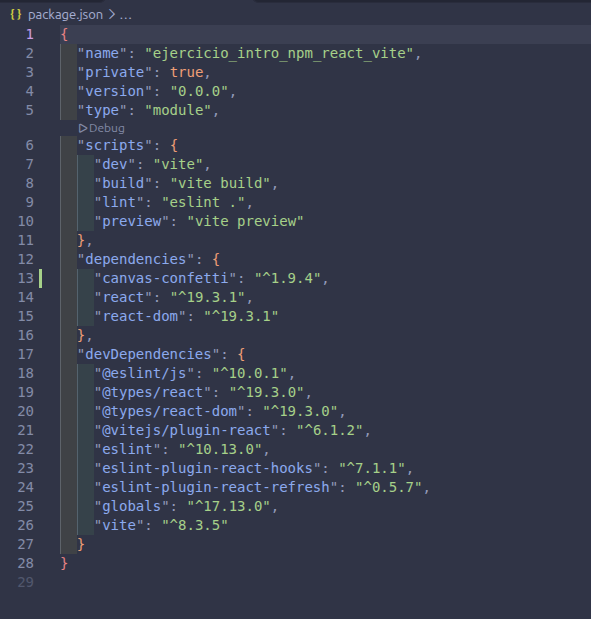
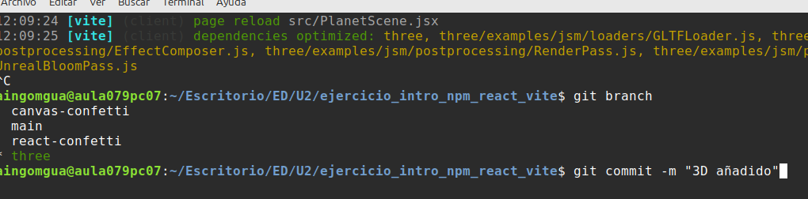

## Capturas del proceso

Punto 4:

Punto 5:

_punto5.png)

Punto 6:

## Si la carpeta node_modules/ está excluida, ¿borrar una dependencia hace alguna acción sobre el repositorio? ¿Cuál?

No si la carpeta está bien excluida en gitignore, ya que la borrariamos en local.
